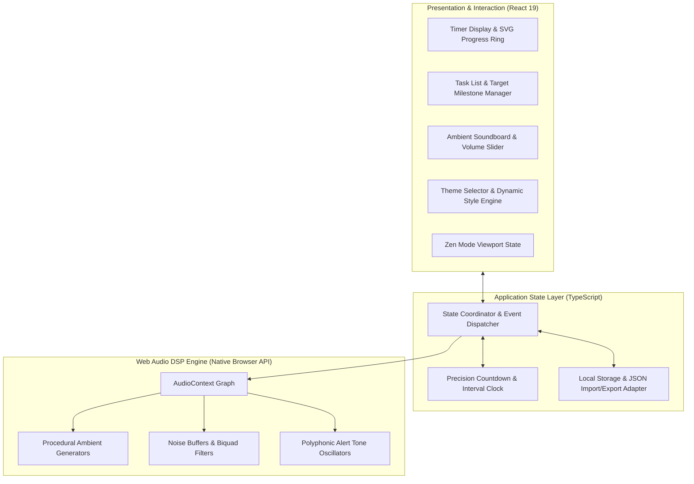

# ⏱️ Pomodoro Focus (Lo-Fi & Retro Aesthetic Hub)

A minimalist, high-productivity focus workstation featuring real-time Web Audio procedural ambiance, 12 aesthetic themes, task lifecycle management, and deep productivity telemetry.

Built with **React 19**, **TypeScript**, **Vite**, and the native **Web Audio API**.

<div align="center">

[](https://react.dev/)
[](https://www.typescriptlang.org/)
[](https://vitejs.dev/)
[](https://developer.mozilla.org/en-US/docs/Web/API/Web_Audio_API)
[](https://github.com/Andreyy05/pomodoro)
[](LICENSE)

</div>

---

## 📋 Overview

**Pomodoro Focus** is an engineering-first personal productivity environment engineered for deep work sessions. Unlike conventional timer utilities that rely on heavy pre-recorded MP3 assets, intrusive advertisements, or cloud tracking, Pomodoro Focus runs 100% locally in the browser.

The platform integrates a high-precision countdown engine, procedural sound generators synthesized on the fly via the browser's native **Web Audio API**, 12 dynamically injected design token themes, a task tracker with target interval milestones, and full JSON data portability.

---

## ⚡ Technical Specifications & System Attributes

| Dimension | Architectural Implementation | Technical Benefit |
| :--- | :--- | :--- |
| **Audio Synthesis** | 100% Procedural DSP via Web Audio API Nodes | Zero external audio asset downloads; instantaneous playback |
| **Execution Model** | Client-side only / Service worker compatible | Completely offline-capable with zero cloud latency |
| **Timer Precision** | Drift-compensated tick intervals via high-res timestamps | Eliminates background tab throttling drift |
| **Data Architecture** | Local-First persistence with schema validation | Zero telemetry, zero accounts, complete user data sovereignty |
| **Theming System** | Dynamic CSS Custom Property injection tokens | Instant visual style morphing without layout recalculations |
| **Data Portability** | Bi-directional JSON Export & Import engine | Effortless backup, migration, and task synchronization |

---

## 📊 Key Capabilities

### ⏱️ Adaptive Pomodoro Engine
* **Interval Modes:** Seamless switching between *Focus* (default 25m), *Short Break* (default 5m), and *Long Break* (default 15m).
* **SVG Vector Progress Ring:** High-precision circular progress visualization featuring dynamic glow shaders matched to the active color theme.
* **Quick Extension Controls:** Instant one-click timer adjustments (`+1m`, `+5m`, `+10m`) for uninterrupted workflow extensions without resetting interval history.
* **Configurable Cadence:** Automated cycle progression with optional automatic transition triggers for breaks and focus intervals.
* **Synthesized Audible Alerts:** Procedural notifications including *8-bit Retro*, *Lo-Fi Bell*, *Digital Watch*, *Fanfare*, and *Marimba*.

### 🎧 Procedural Web Audio Ambient Player
Every soundscape is generated mathematically in real time directly within the browser's audio graph using oscillators, white/pink noise generators, and biquad filters:
* **C418 Minecraft Ambiance:** Procedural soothing melodic tones inspired by atmospheric sandbox soundtracks.
* **Lo-Fi Chords:** Warm, slowly evolving electronic chord progressions with analog filter sweeps.
* **Rain & Thunder:** Multi-layered precipitation noise modulation with low-frequency rumble synthesis.
* **Campfire:** Dynamic crackle synthesis simulating acoustic timber combustion.
* **Vinyl Crackle:** Low-pass filtered random pop-noise modeling analog turntable surface friction.
* **Ocean Waves:** Rhythmic white noise frequency modulation imitating coastal tidal swells.
* **Night Crickets:** High-frequency pulse modulation generating nocturnal ambient fields.
* **White Noise:** Uniform spectral density acoustic masking for maximum auditory distraction cancellation.

### 🎨 12 Curated Visual Themes
Instantaneous aesthetic transformation across all UI components:
* **Lo-Fi Chill:** Mellow purple glow and deep midnight tones.
* **Minecraft:** Earthy green and mineral textures inspired by voxel exploration.
* **80s Retro:** High-contrast neon cyan and magenta synthwave ambiance.
* **Sakura Zen:** Delicate cherry blossom pink paired with warm charcoal.
* **Miami Dusk:** Vibrant gradient palette capturing coastal evening skylines.
* **Cozy Coffee:** Rich espresso, crema, and warm timber accents.
* **Matcha Zen:** Soothing organic tea green and slate.
* **Nordic Frost:** Minimalist alpine blues and crisp monochromatic elements.
* **Dracula:** Deep purple, dark slate, and high-readability pastels.
* **Cyberpunk:** High-visibility electric yellow and onyx.
* **Ocean Breeze:** Maritime deep cyan and navy gradients.
* **Crimson Sunset:** Saturated crimson and warm amber hues.

### 🧘 Distraction-Free Zen Mode
* Instant single-key transition (`F`) into a hyper-focused, minimal viewport.
* Conceals peripheral controls, secondary modals, and task sidebars, displaying only the timer ring and current active task.

### 📝 Focus Task Management
* Task lifecycle management with target pomodoro estimates (`target 🍅`).
* Prominent **Active Task** binding displayed in the main timer viewport.
* Automatic task completion confetti explosion upon meeting target intervals.
* Quick status sorting (*All*, *Active*, *Completed*).

### 📊 Productivity Telemetry & Analytics
* Daily completed session counters with progress tracking toward personalized goals.
* **7-Day Visual Activity Matrix:** Daily performance charts mapping focus trends throughout the week.

### 💾 Local-First Data Portability
* Full local persistence across all tasks, timer custom durations, active theme, and historical stats via `localStorage`.
* Integrated **JSON Data Backup**: One-click export and import of complete application state.

---

## 🏗️ Architectural Design



---

## 🧩 Technology Stack

### Core Engine & Presentation
* **UI Framework:** [React 19](https://react.dev/)
* **Type System:** [TypeScript 7](https://www.typescriptlang.org/)
* **Build System:** [Vite 8](https://vitejs.dev/)
* **Audio Synthesis:** Native Browser [Web Audio API](https://developer.mozilla.org/en-US/docs/Web/API/Web_Audio_API)
* **Iconography:** [Lucide React](https://lucide.dev/)
* **Particle Physics:** [canvas-confetti](https://www.npmjs.com/package/canvas-confetti)
* **Code Quality & Linter:** [Oxlint](https://oxc.rs/)

---

## ⌨️ Keyboard Controls and Navigation

| Key | Operation |
| :---: | :--- |
| `Space` | Toggle Timer (Start / Pause) |
| `F` | Toggle Zen Fullscreen Focus Mode |
| `M` | Master Mute / Unmute Ambient Audio |
| `?` | Open Keyboard Shortcuts Cheatsheet |

---

## 📁 Project Structure

```text
pomodoro/
├── public/                     # Static icons, manifest, and favicon
├── src/
│   ├── assets/                 # SVGs and branding graphics
│   ├── components/             # Modular React components
│   │   ├── AmbientPlayer.tsx   # Real-time Web Audio ambient control board
│   │   ├── SettingsModal.tsx   # Interval durations, alarm picker, and goal targets
│   │   ├── ShortcutsModal.tsx  # Keyboard navigation quick reference
│   │   ├── StatsModal.tsx      # 7-day productivity telemetry & trends
│   │   ├── TaskList.tsx        # Task manager with target intervals & filtering
│   │   ├── ThemeSelector.tsx   # 12-palette design token theme switcher
│   │   └── Timer.tsx           # Precision SVG countdown ring & quick adjustments
│   ├── utils/
│   │   └── audio.ts            # Web Audio API synthesizers & procedural DSP algorithms
│   ├── App.tsx                 # Central state coordinator & shortcut listener
│   ├── index.css               # Global theme tokens, typography, and animations
│   ├── main.tsx                # React DOM mounting entry point
│   └── types.ts                # TypeScript domain models and interfaces
├── index.html                  # HTML5 shell
├── package.json                # Project dependencies & operational scripts
├── tsconfig.json               # TypeScript compiler specification
└── vite.config.ts              # Vite bundling pipeline
```

---

## 🚀 Installation and Build Instructions

### Prerequisites

* **Node.js:** v18.0.0 or higher
* **npm:** v9.0.0 or higher (or `pnpm` / `yarn`)

### Setup & Development

1. **Clone the repository:**
   ```bash
   git clone https://github.com/Andreyy05/pomodoro.git
   cd pomodoro
   ```

2. **Install project dependencies:**
   ```bash
   npm install
   ```

3. **Start local development server:**
   ```bash
   npm run dev
   ```
   Open your browser at `http://localhost:5173/`.

4. **Compile production build:**
   ```bash
   npm run build
   ```
   Optimized static assets will be bundled into the `dist/` directory.

5. **Lint source code:**
   ```bash
   npm run lint
   ```

---

## ⚙️ Configuration Parameters

Accessible directly via the in-app **Settings** modal:
* **Focus Duration:** Default 25 minutes (adjustable from 1 to 90 minutes).
* **Short Break Duration:** Default 5 minutes (adjustable from 1 to 30 minutes).
* **Long Break Duration:** Default 15 minutes (adjustable from 5 to 60 minutes).
* **Long Break Frequency:** Interval frequency count before triggering a long break.
* **Auto-Start Progression:** Toggles automated sequencing between focus and break sessions.
* **Daily Goal:** Target completed pomodoro threshold per 24-hour cycle.
* **Alarm Sound Selection:** Selectable procedural audio synthesis algorithm.
* **Data Management:** Full JSON backup creation and state restoration.

---

## 📄 License

Distributed under the MIT License. See [LICENSE](LICENSE) for full legal text.

---

<div align="center">
  Author: <b>Andrej Pavliščak</b> (<a href="https://github.com/Andreyy05">@Andreyy05</a>)
</div>
